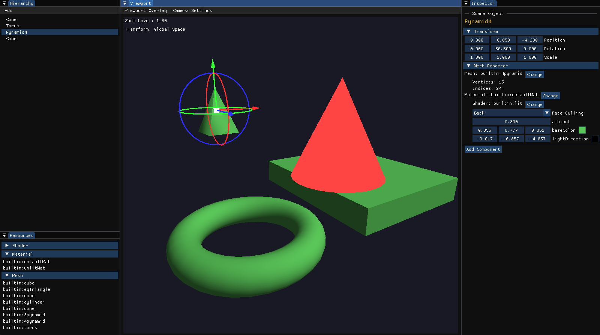
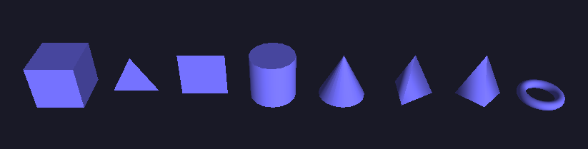
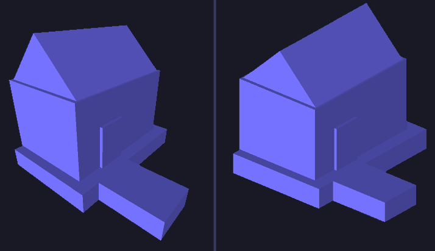
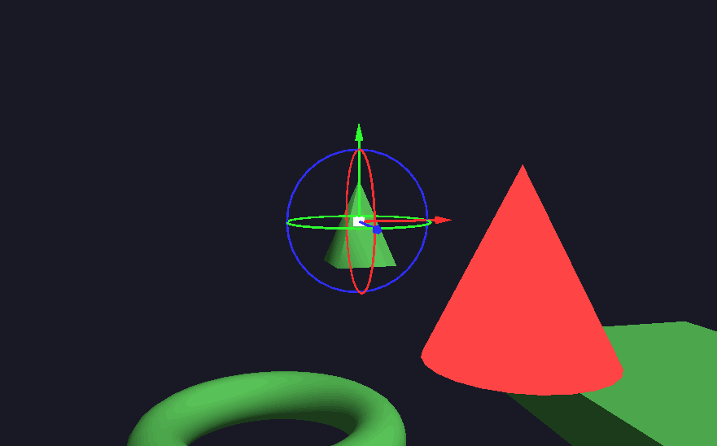
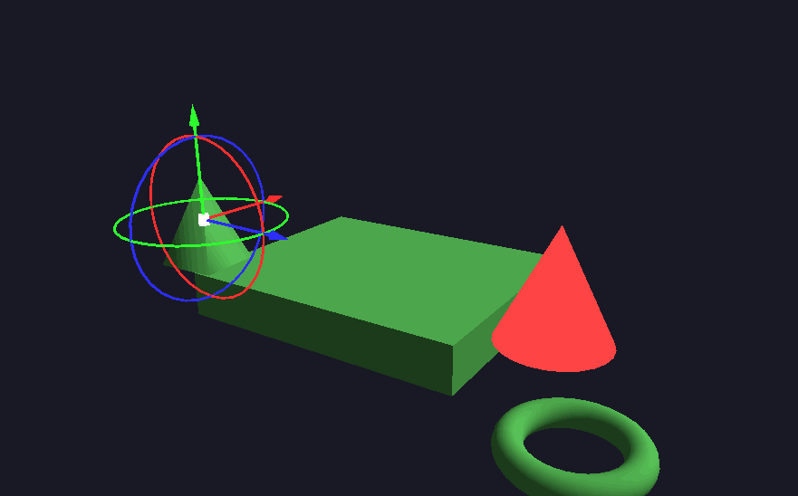

# LevelDesignEditor
Custom Engine in C++ made to quickly prototype level design

This is a WIP project that I'm currently using to learn C++. The idea is to create a lightweight tool to prototype level blockouts and export them as a glb scene.
The UI closely mirrors Unity's editor, following the same architecture of scene objects that hold components.
More details to come in the future.

## A few implemented features...

I have implemented a few default meshes to work with: Triangle, Quad, Cube, Cylinder, Cone, Pyramids, and Torus:

I also found relevant the inclusion of an isometric camera, to have support for games with this kind of projection.

I implemented three types of camera movement: free camera flight (default), panning camera, and orbital camera (arcball).

  
  
  

## Roadmap
### MVP
- Gizmos rendering + controls
	- (free) Viewport object selection
- Serialization -> resources
	- Resources creation
	- importer or exporter: obj, gltf, '.ldscn'
- Transform Hierarchy
	- Account for delete children, duplicate in place

### Nice to Have
- Rendering: shadows, textures
- Mass select -> duplicate/delete
- Material instances: 
	- material resource serves as a template
	- each object can override the default values
- Scene Cameras: override editor camera rendering and controls
- Performance: frustum culling
- Resources: advanced view on inspector (render mesh/material)

### Future Work
- Mesh Editor!
- Procedural mesh generation
